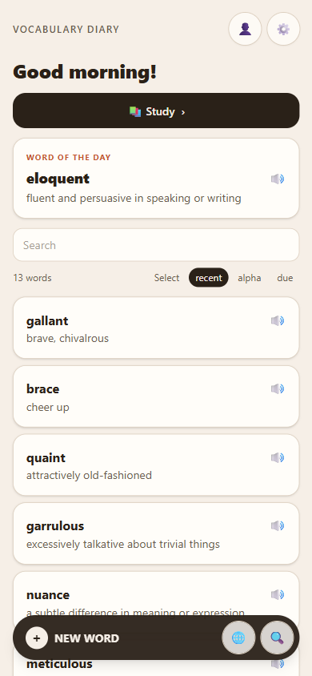

<div align="center">

# 📖 Vocabulary Diary

**A private, offline-first vocabulary journal — installable on any phone, forever.**

*Your words. Your device. No accounts, no subscriptions, no weekly re-signing.*

[](LICENSE)
[](#install-on-iphone)
[](#storage--privacy)
[](#development)

</div>

---

<div align="center">



*Home — word of the day, one-tap study, and every word you've collected.*

</div>

## Why

Most vocabulary apps lock your words behind an account, nag you with a paywall, or expire your "install" every 7 days. This is the opposite:

- 🗄 **All your data stays on your device** — IndexedDB, no server, no tracking
- 🧠 **Real spaced repetition** — clean-room SM-2 with six grading levels, lapse handling and fuzz
- 📴 **Fully offline** — service worker precaches the entire app; study without a signal
- 🧩 **Zero install friction** — Add to Home Screen and it behaves like a native app
- 🔀 **Bring your own AI** — translation & example generation through your own OpenAI/Gemini key (optional, disclosed, stored locally)

## Features

| | |
|---|---|
| 📚 **Library** | search, sort (recent / alpha / due), filter by tag & language, bulk actions, word of the day |
| ✍️ **Word pages** | meaning, part of speech, additional meanings, pronunciation (IPA), example sentences, notes, tags, synonym links |
| 🎓 **Study modes** | flashcards · multiple choice · typing · listening · matching |
| 📈 **Progress** | daily activity heatmap, streaks (day-start aware), XP levels (`150·(n−1)²` curve), mastery tiers |
| 🌐 **Translate** | BYOK AI translation with one-tap "save as word" |
| 📥 **Import** | JSON (lossless backup) · CSV · Markdown · TXT · PDF |
| 📤 **Export** | JSON · CSV · Markdown · TXT · PDF (styled A4 with embedded fonts — IPA & Cyrillic safe) |
| 🔗 **Deep links** | `#/add?word=…&translation=…` — add words from Shortcuts or any share flow |
| 🌙 **Themes** | light / dark / system |

## Install on iPhone

1. Open **https://tushar49.github.io/vocab-diary/** in Safari
2. **Share → Add to Home Screen**
3. Done — it runs standalone, offline, and never expires

> Installed home-screen web apps are exempt from Safari's 7-day storage eviction, and the app requests persistent storage on top. Keep periodic **JSON backups** (Settings → Data) as belt-and-braces.

## Storage & Privacy

- Words, reviews, streaks and settings live **only** in your browser's IndexedDB — nothing is transmitted anywhere
- AI features are strictly **bring-your-own-key**: the key is stored locally and only used for the request you trigger
- Moving phones? Export the JSON backup on the old phone → AirDrop/Files → import on the new one (SM-2 scheduling state survives)

## Development

```bash
pnpm install
pnpm dev          # http://localhost:5173
pnpm typecheck    # tsc --noEmit
pnpm test         # vitest — 59 tests
pnpm build        # production build + service worker
```

<details>
<summary>Architecture</summary>

```
src/
  core/      pure logic: sm2, xp, grades, search, parsers, pdf(+import), date  (+ vitest suites)
  db/        Dexie schema + repositories (words, reviews, daily stats, search index)
  study/     session engine: mode selection, due-first queue, ordering
  platform/  speech (TTS), deep links, storage persistence
  ui/        components + 9 screens: Library, AddEdit, WordDetail, Study,
             Progress, Settings, Translate, Import, Onboarding
scripts/     gen_icons.py (original icon, stdlib-only), convert-fonts.mjs
```

- Export/import formats: `src/core/parsers.ts`; the PDF export layout (`src/core/pdf.ts`) and its parser (`src/core/pdfImport.ts`) are a contract — font sizes included
- JSON is the fidelity format (SM-2 state, streaks, ids); CSV/Markdown/TXT are intentionally lossy
- Agent conventions: see [AGENTS.md](AGENTS.md)

</details>

<details>
<summary>Roadmap</summary>

- [ ] Weekly backup reminder
- [ ] Tag colors
- [ ] Web Push word-of-the-day notifications (needs a tiny serverless function)
- [ ] Cross-device sync (Supabase, opt-in)
- [ ] Photo → word via AI vision

</details>

## Deploy your own

Fork → push → **Settings → Pages → Source: GitHub Actions**. Every push to `main` runs typecheck, tests, build and publishes the PWA. `vite.config.ts` uses relative base paths, so it works from any subpath.

## License

[MIT](LICENSE) — original, clean-room implementation. No third-party app code, assets, or branding involved.
